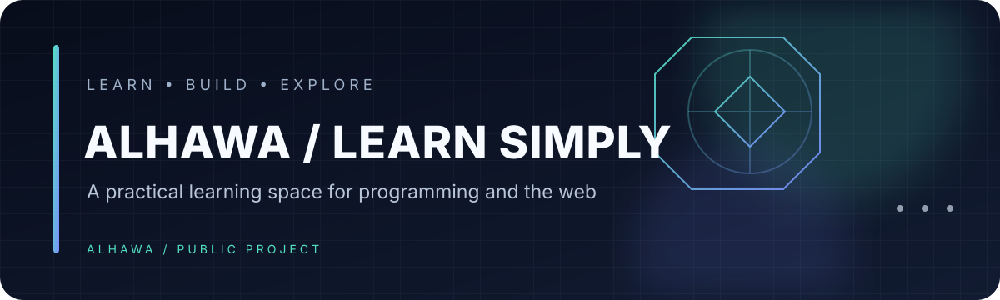

# Alhawa · Learn Simply

A beginner-friendly multimedia learning website built around clear introductions to programming and web fundamentals.

## What you'll find
- **C++** — an introduction to a versatile, performance-oriented language.
- **Python** — readable programming foundations and a broad ecosystem.
- **Java** — object-oriented programming and cross-platform applications.
- **HTML & CSS** — the building blocks of structured and styled web pages.
- **Learning media** — embedded images, audio, video, and supporting pages.
- **Companion pages** — project information, sign-in mock-up, and CSS examples.

## Run locally
1. Download or clone this repository.
2. Open `index.html` in a modern browser.
3. Keep the existing media and PDF files in their current relative locations.

> This is an educational front-end project. The sign-in page is a demonstration unless a real authentication backend is added.

## Project structure
| File | Purpose |
|---|---|
| `index.html` | Main learning page |
| `style.css` | Main visual styles |
| `Musa.html` | Project/about page |
| `css_styles.html` | CSS examples |
| `signin.html` | Sign-in interface demonstration |

---

<b>ALHAWA</b> · Learn simply. Build confidently.

